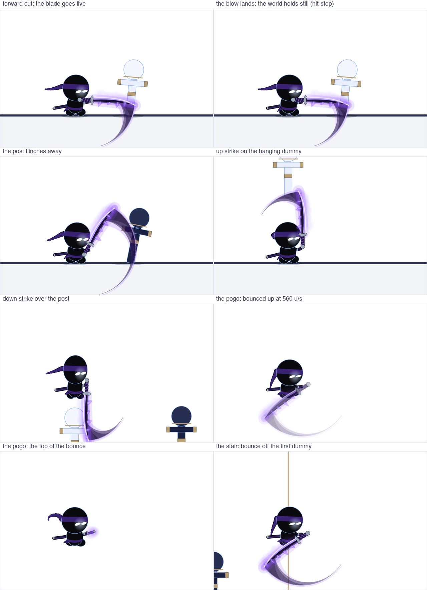
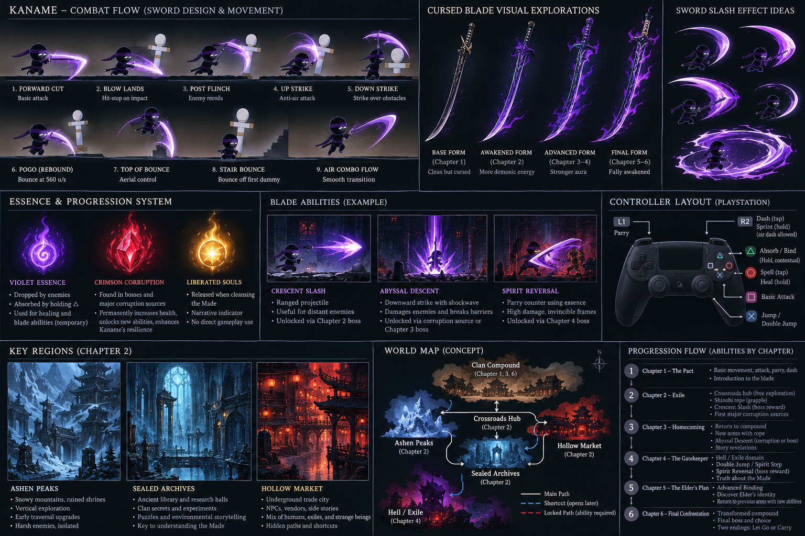

# KANAME — Animation, Character and Katana Polish Brief

**Priority:** Current milestone / send with the existing Unity project and image references. **Audience:** Opus for inspection/plan; Sonnet for implementation. **Scope:** polish EXISTING visual/animation work without rebuilding movement or adding future systems.

## 1. Context and design direction
Kaname is a compact, slightly cute but striking masked 2D shinobi with a dark/navy-blue body, glowing eyes, a purple trailing headband, a visibly cursed **right arm**, and a katana-like blade. Stay faithful to the existing recognizable silhouette. The weapon is **a beautiful, unmistakable katana, never a scythe**. Purple is the visual identity of the curse; do not make VFX so large or opaque that they obscure the character or hitbox.

The user **already has** jump, dash (including airborne), sprint, basic forward sword swing, upward strike, downward strike and pogo/bounce working in Unity. Inspect project scripts, sprites, animator and actual scene behavior before editing. Preserve gameplay behavior unless there is an agreed defect.

## 2. Sprite/character model polish
- Preserve round readable head, expressive luminous eyes, compact body and headband tail silhouette.
- Distinguish the cursed right arm subtly at base level: restrained scar/marking, wrapped gauntlet, violet edge-glow; do NOT need a fully new character rig.
- Keep sword shape readable during idle, startup and strike: hilt, guard, blade spine and pointed cutting tip distinct.
- The blade can become progressively more awakened later, but **do not implement chapter-based upgrades in this milestone**.
- Favor consistent silhouettes and anchor points over fine detail that will disappear at gameplay camera scale.

## 3. Sword and slash direction
- Physical blade: clean dark-steel katana/shinobi sword with controlled violet luminous cutting edge; keep its real silhouette visible during active frames.
- Two-layer slash FX:
  1. **Inner sharp crescent** aligned with actual *damage* region; distinct brightest line and finite sharp tip.
  2. **Outer translucent afterimage** with short violet diffusion/trails; aesthetic only.
- Current purple effect can look like an enormous scythe; shrink and reshape its visual mass to follow a sword *trajectory*, not become a second hooked weapon.
- Hitbox and inner crescent must correspond closely. Outer FX can exceed hitbox slightly, but never imply a damaging area that is not real.
- Maintain strong impact hit-stop, controlled camera shake if already used, and a small impact spark. Preserve animation determinism; don't let VFX delay player inputs.

## 4. Existing animation refinements

| Move | Distinct pose/readability | Impact and recovery check |
|---|---|---|
| Jump | Compact takeoff, trailing bandana, distinguish ascent/apex/fall | Preserve current jump arc and input buffering if any |
| Dash / air dash | Low, streamlined silhouette; sharp direction trail; visible distinction from sprint | Preserve tap R2 instant dash, including air; avoid redefining air-dash count without inspection |
| Sprint | Sustained forward lean and steady stride/cloth movement, **less explosive** than dash | Preserve hold R2 transition into sprint; no accidental repeated dash |
| Forward attack | Recognizable small wind-up; hip/shoulder rotation; dominant lateral blade path | Responsive startup; small hit-stop and recoil on actual hit |
| Up strike | Blade starts low/off-side, body compresses and rotates upward; unmistakable vertical line | Anti-air hitbox aligns with violet inner crescent; distinct from forward attack |
| Down strike | Blade visually aimed at target beneath feet; legs/tucked body clear in air | Readable active downward frames, controlled follow-through |
| Pogo bounce | Distinct impact squash/spark + upward recovery pose; optionally unique sound/cursed flare | A valid down-attack target yields immediate reliable upward rebound; chainable dummy/platform sequence |

**Do not hardcode guessed frame counts.** First document existing frame rate, animation clip durations, input buffering, hit-stop, attack locks and physics update rate. Make timing adjustments from a baseline and test them in play. If numeric proposals are useful, label them *initial tuning*, not fixed requirements.

## 5. Controller contract (current agreed intent)
- L1 parry; R2 tap dash (air dash allowed), R2 hold sprint.
- Square sword attack; Cross jump/double jump when acquired.
- Circle tap spell, hold heal (later system).
- Triangle **hold** to absorb floating Essence; binding/cleansing is the **same contextual hold** and requires a visible, valid game prompt. Do not introduce separate tap-versus-hold actions for these.
- Some mappings may not yet be implemented; **do not create or refactor them in this polish-only milestone**.

## 6. How to evaluate current eight panels
Source image includes: forward cut; blow lands/hit-stop; training post recoil; up strike on hanging dummy; down strike; pogo bounce at noted 560 units/s (source annotation, NOT mandatory physics target); top of rebound; bounce off first dummy.

- Confirm each panel's primary sword and arc align; present an overlay of blade edge vs hitbox for startup/active/recovery if tools permit.
- Forward and up attack need uniquely recognizable anticipation poses.
- Pogo must be tuned by **actual Unity movement testing**: bounce velocity, landing reset, collision layers, animation cancel/recovery and air dash interplay. Do not assume the screenshot's `560 u/s` is appropriate for current scene scale.

## 7. Step-by-step instruction to Claude Code
1. **Inspect, do not edit yet.** Identify Unity project version, animation system, files, player controller, source sprites/VFX, input actions and hitbox scripts. Note potentially destructive modifications.
2. Report short prioritized diagnosis and propose lowest-risk improvements; ask permission if substantial rig/sprite rework is unavoidable.
3. With approval, edit only current character and attack animation/VFX components; retain physics and working scripts unless correcting a demonstrated issue.
4. Use original source art where available. If an asset must be created manually, tell the developer exactly what size/layout and import setup are needed; don't pretend a generated reference image is a native sprite-sheet or Unity prefab.
5. Compile/test accessible checks; provide manual playtest scenarios and before/after screenshots or videos when feasible.

## 8. Acceptance criteria
- Sword looks like a katana at normal gameplay scale, not a scythe.
- Physical blade remains visible under FX; hitbox tracks luminous inner crescent.
- Forward, up, down strikes have recognizable startup and follow-through.
- Pogo produces consistent, immediate rebound and readable impact when striking valid targets.
- Existing jump/sprint/ground dash/air dash still work as before.
- No new compile errors, broken Animator transitions, missing references or unapproved mechanics.
- Document outstanding playtest-only issues explicitly.

## 9. Short prompt to send with this file
> Read `CLAUDE.md`, `Docs/COMBAT_ANIMATION.md`, and `Docs/briefs/IMPLEMENTATION_001.md`. Inspect my existing Unity character/Animator/controller and `Docs/references/kaname_current_attacks.png`. I have working jump, dash (including air), sprint, forward/up/down attacks and pogo. First **plan only** the smallest set of changes to make Kaname's cursed right arm clearer, his sword read as a beautiful katana rather than a scythe, his forward/up strike startup poses distinct, and his pogo effects/response clearer. Preserve working movement and do not add unrelated abilities or systems. Report exact files, implementation steps and how we will test them in Unity.
