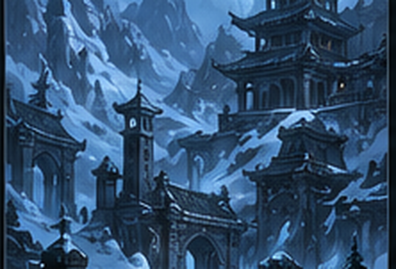
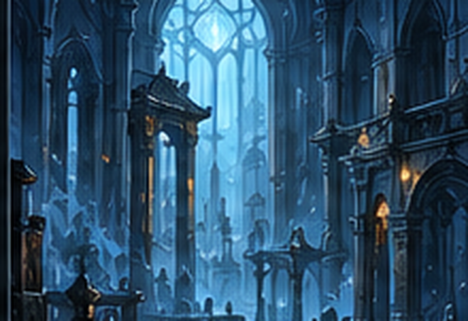
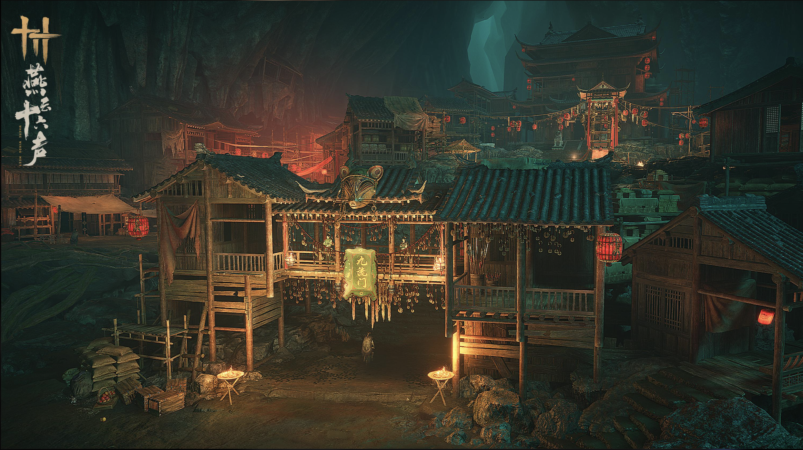
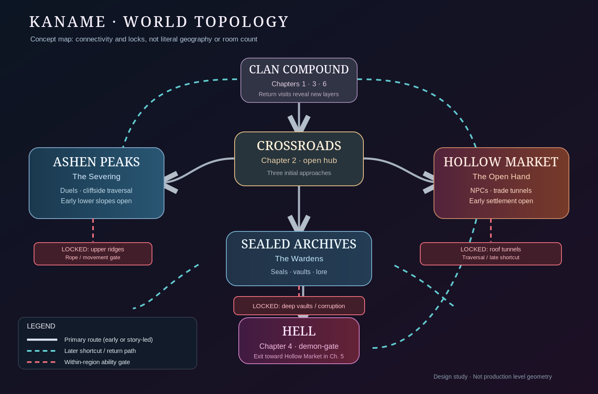

# KANAME — Narrative and Game Design Bible

**Version:** 0.1 working design / approved conversation direction, October 2026  
**Platform/engine:** Existing Unity 2D prototype, solo-developed with Claude Code assistance.  
**Purpose:** This is the **creative source of truth**, *not* an instruction to implement six chapters in one run.  
**Document companions:** [Start Here](../README_START_HERE.md) · [Current Animation Brief](COMBAT_ANIMATION.md) · [World Map](WORLD_MAP.md) · [Decision Register](DECISIONS_AND_OPEN_ITEMS.md) · [Implementation 001](briefs/IMPLEMENTATION_001.md)

> **Canon convention.** Sections labeled **Locked** represent explicitly accepted concepts. **Proposed** marks refinements subject to validation. Specific dialogue, room geometry, boss moves, numeric balancing and exact order of minor rewards are *not* final canon.

---

## 1. One-paragraph pitch and design pillars — Locked

*Kaname* is a compact, dark-fantasy 2D action Metroidvania about a young shinobi who accepts a forbidden cursed blade to save his clan, is exiled for that sacrifice, and eventually discovers that his beloved Elder engineered his entire life to make him the perfect vessel for a primordial lord of Hell. As Kaname masters a blade that absorbs Essence, he learns that some of the demons he's fought were once people. The player explores interconnected regions, learns precision parry/dodge combat, unlocks traversal and sword abilities, and ultimately chooses whether to destroy the curse forever or carry it to preserve a chance to restore its victims.

**Pillars:** (1) readable responsive swordplay, pogo and parry mastery; (2) semi-open, interconnected Metroidvania exploration; (3) environmental storytelling with sparse NPC dialogue and concise cutscenes; (4) tragic enemies and bosses whose mechanics reinforce the story; (5) highly personal Elder betrayal; (6) disciplined solo-project scope.

**Creative influences (direction, never assets):** Hollow Knight / Silksong for world, NPC density, healing/spells and quiet discovery; Nine Sols, Sekiro and Prince of Persia: The Lost Crown for deliberate telegraphed combat, deflection and traversal; Castlevania for action exploration; Souls series for bosses and ambiguous lore; Bleach for an Aizen-like long conspiracy; Baldur's Gate 3's Wyll for a costly bargain and exile; DOOM (2016) and Onimusha for Hell power exploitation and satisfying essence absorption. Do not copy copyrighted characters, sprites, soundtrack, maps or code.

**Central line / thematic lens:** *The Elder knew exactly how to make Kaname strong, but never understood what kind of person he would become.*

### Themes — Locked
- **Free will vs. manipulation:** Elder controls circumstances, never guarantees Kaname's moral choices.
- **Love vs. possession:** mother changes the lullaby to preserve agency; Elder loves his constructed family possessively and confuses ownership with salvation.
- **Sacrifice and duty:** Kaname pays with himself to save others; council pays with other people's children for power.
- **Identity beyond purpose:** a vessel can choose to protect others without surrendering autonomy.
- **Ends and means:** Severing, Wardens and Open Hand all committed atrocities while claiming a moral necessity.
- **Mercy and burden:** restoration or release, neither ending morally effortless.

---

## 2. Kaname and immediate cast

### Kaname — Locked
- Named 要, the **pin that holds a folding fan together**; opens thematic interpretation as the stabilizing point of two realms, but he can refuse that assigned purpose.
- Approximately **16 at the Chapter 1 pact**; roughly **four years of exile** before homecoming (timeline provisional from original script).
- Compact dark/blue young shinobi; face mask, bare arms in original script, dark purple trailing headband, luminous eyes in current Unity visual direction; cursed **right forearm** and blade.
- Restrained, dutiful, dry humor that becomes a defense against rejection. His desire shifts from *protect family → be accepted by clan → learn the truth/save family → release victims → choose his own purpose.*
- His arm **does not randomly steal player control** in routine gameplay. A brief first-act moment when the curse moves it on its own remains a story warning, not a frustrating mechanic.

**Act-to-act expressive beats (low-dialogue design):** initial revulsion at absorption; later numb/resigned post-combat gestures; a joke failing with silence; shock on finding bedroom observation shaft; kneeling next to the Made after revelation; eventually ceasing to hide his cursed arm around brother/healers. Prioritize sprite/body language over many cutscenes.

### The Elder / Patron — Locked
- Clan godfather, Kaname's surrogate father and beloved mentor; secretly a **primordial being/lord of Hell** behind the founding pact.
- Physically present in mortal world through a **limited manifested body**, lacking his full Hell-realm power. Destruction of that manifestation is not annihilation of his underlying essence and costs power to replace; no omnipotent clone army.
- Wants Kaname to become a fully empowered mortal vessel. With that vessel he can stabilize and tear open the boundary beneath the mountain, **merge Hell with the mortal world**, and remake humanity into undying, demonic-adjacent existence.
- **He sincerely believes** mortality, separation and grief are intolerable and the new order is a gift, even though it destroys autonomy and bodies. This is not a benevolent outcome.
- He exploits a clan that believes it is exploiting demonic power to become unbeatable. His possession is an act of 'love' on his terms.
- Can plan raid, exile, homecoming and Hell fall, plant cranes, manipulate council, but cannot foresee Kaname's compassion or guarantee a successful ritual.
- Blade is eventually capable of severing his core essence (Let Go) or binding it within Kaname (Carry): he manufactures his one meaningful threat.

### Mother — Locked
- Hums a childhood lullaby. Suspects something in the clan's treatment/tonics and **changes one note** in the ritual melody whenever she sings privately to Kaname. This disrupted conditioning over many years, **allowing but not guaranteeing** resistance.
- Gives Kaname a spare sanctum key at the attack (a custom Elder had taught her); later questions his treatment, takes his side and is sent through gate with the younger brother.
- Dies in Chapter 4 not because Kaname embraces the forced one-or-other bargain, but because the cage mechanism collapses even after he defeats its keeper. Her instruction to save brother and his attempt to save both create tragic consequence.
- A brief final line can disclose that the Made were children; do not give a dying character a long exposition dump.

### Younger brother (original script: younger sibling) — Locked direction
- Ch. 1: flinches at cursed arm, immediately reaches for Kaname, ashamed of fear; this is what prompts voluntary exile.
- Ch. 4: saved from cages; shock, grief, and some initial emotional distance.
- Ch. 5: at a rest site quietly covers Kaname's trembling cursed arm with mother's cloth or leaves him a folded crane; a true loving crane reframes Elder's manipulative cranes.
- Epilogue: willingly holds his brother's hand in either ending. Distinct acceptance arc without turning him into a major quest-giver.

### Father — Locked direction
- Council elder. Participated in experiments/tonic treatment under a duty-and-survival rationale; unlike others doesn't flinch at cursed arm because he knew.
- Endorses exile but gradually doubts after seeing Kaname is never intended to return; uncovers Elder's larger aim; tries to intervene, too late; Elder arranges his death in exile year three.
- Discovery through memorial claiming rival raiders killed him, unsent guilty letter, mother's tonic ledger, and contradictory evidence, not a long father's ghost monologue.
- Candidate optional line (not locked): 'I called it duty because I was too afraid to call it what it was.'

### Recurring supporting cast — Proposed scope-limited beats
- Ferryman, widow, child, traveling healer: initial wariness, modest aid, one return interaction showing changed perception; avoid large branching dialogues.
- Open Hand healer shelters brother despite faction pressure; supports changing allegiance through action, not a global 'everyone bows' scene.
- Severing holdout refuses reconciliation even after final alliance; some ideological conflict persists.
- Council survivor in Ch. 6 can admit council knew it was breeding a weapon but not a body for the Elder, then assist/sacrifice.

---

## 3. Six-chapter story: playable and emotional beats

### Chapter 1 — The Night of the Pact / tutorial — Locked
**Place:** mountain clan compound at dusk. The council and most fighters leave to intercept purported Severing raiders. Dogs are uneasy. The sanctum is sealed and key taken. Family, younger sibling, Elder and a few guards remain. Mother hums the *altered* lullaby.

1. Demons attack, unusually ignoring easier prey to target Kaname. He promises to hold the gate, cracks a nervous joke; player learns sword movement, attacks and basic defensive vocabulary with combat dummies/demons.
2. Elder supplies **rope** with suggestive 'Whatever you choose, you choose it for them'; mother supplies a spare key. The forbidden hall is suspiciously swept. These are retrospectively staged preparations.
3. Kaname accepts a cursed black-violet blade bound to his **right arm**. He recoils on first Essence absorption, cannot discard the sword; it returns to sheath.
4. Boss: **Assault Commander**. For an instant curse moves his arm and he fears losing control; not routine player-control interference.
5. At dawn council returns suspiciously soon. Father asks about blade first. Exile law punishes demonic bargaining. Elder publicly protests. Brother flinches and reaches back; Kaname chooses exile to protect family. No explicit conditions given for return.

**Player knows:** heroic sacrifice, ostracism, eerie circumstances. **Do not reveal:** Elder's identity, engineered attack, Made origins.

### Chapter 2 — The Road of Exile / primary semi-open hub — Locked
**Time:** ~four years later. Kaname has decided to master the curse and defeat the exile lands' worst demons so his clan *has* to take him back. Road centers on a **Crossroads** serving three branching yet interconnected territories: Ashen Peaks / Severing, Sealed Archives / Wardens, Hollow Market / Open Hand.

- Player can enter all three early; upper/deep sections are gated by traversal, seals and corruption barriers. No order-dependent exposition critical to main plot. Encounters and environmental evidence differ in mood and mechanics.
- **Severing**: merciless, disciplined fighters; commander cut off her own cursed arm; she says 'The demons are not born. They are made.' (hint, not full reveal).
- **Wardens**: ancient sealed prison, Keeper with many seals; a shared Warden script beneath clan marks on blade raises questions. Claims clan has an older Patron.
- **Open Hand**: merchants, healers, hired blades shelter cursed for a price; broker reminds Kaname 'You are not a weapon. You are a body.' Warm but compromised society.
- At each rest stop Kaname occasionally finds a **paper crane** planted by unseen guidance and hears fragments of lullaby; the Elder's care is later revealed as manipulation.
- Ordinary people flinch, sometimes help. Kaname grows resigned to absorbing Essence. One demon uses familiar clan techniques; bodies of rival scouts near home were mislabeled as raiders to sustain feud.
- Chapter culminating confrontation: **Exile Demon**, strongest local threat, warns 'Your family did this to you.' A message from home / signs of trouble propel Kaname to return early, still outcast and not 'ready.'

**Character tension:** gameplay empowerment while Kaname becomes less happy/hopeful about earning acceptance.

### Chapter 3 — The Homecoming / slow discovery through spatial progression — Locked
1. **Outer cliffs/rooftops:** gate closed; use Elder's rope and exile abilities to infiltrate former home. Daylight compound seems prosperous; father's memorial credits Severing raiders for his death.
2. **Family quarters:** ledger of childhood tonics, father's unsent letter saying he knew and regrets it. Don't explicitly explain all implications. **Hidden observation window beneath his childhood bedroom** physically proves he was monitored.
3. **Council hall:** masked council figures, including one boss **Masked Councillor** with trained shinobi and forbidden demonic moves. They admit clan knew and prepared Kaname for pact, thinking they were building a weapon; masks peel away over encounters.
4. **Hidden prison/laboratories:** explore failed experiments, children's room diagrams, human names, right-arm diagrams, prisoner cells and buried demon-gate. This is environmental horror, not a long lore lecture.
5. **Elder imprisoned:** council appears to execute him in front of Kaname. This actually destroys one costly mortal manifestation; later reveal explains how essence survives. Elder says 'accept it' and passes final paper crane, asks Kaname to save his family; mother and brother already sent through gate for dissent.
6. Kaname rebels and council throws him through demon-gate. The apparent Elder death should be emotionally genuine *to Kaname and player* here.

**Ch. 3 reveals:** council experiments + conspiracy and betrayal. **Withholds:** true purpose of Kaname as Elder's body and Elder's real identity.

### Chapter 4 — The Descent / Hell and the Gatekeeper — Locked
**Environment:** Hell is an actual world, dark reflection under mountain, small warmth amid horror, caged failed vessels and remnants of human rituals. Need not be all featureless lava.

- Meet victims who see Kaname as someone who escaped. Voices offer relief if he surrenders. Some enemies repeat human habits, hum family tunes or carry name-marked possessions.
- **Gatekeeper** is the *first failed vessel*: child once consented in desperation to save family, could not contain the Elder, became the Gatekeeper. He recognizes that Kaname also said yes to save someone; he sings lullaby *one note off* relative to mother's version.
- Cages with mother and brother hang above lava on interlocked chain/counterweight system. Gatekeeper demands Kaname choose one. Kaname **refuses**, fights and defeats him; mechanism survives and becomes unstable. As brother's cage falls, mother cries to save him; Kaname reaches it, mechanism shifts and mother's cage falls beyond rescue. He attempts both, loses mother. Avoid an artificial player 'choose a cage' menu if story outcome fixed.
- Her short warning: some demons are made from children; the clan serves a hidden Patron; Kaname was being prepared to be a *body*, not merely a weapon. Not full elder name/history.
- Escape with brother; Kaname learns demonic Essence absorption can ease the Made's torment and liberate souls. Reinterpret earlier kills; distinguish **true demons**, **partially transformed Made**, **fully transformed Made**.

**Suggested acquisition:** Spirit Step / double jump during Hell or transition into Ch. 4, earned through boss/exploration; placement to be playtested.

### Chapter 5 — The Other Side / truth through revisits — Locked
- Emerge in the **Hollow Market** / Open Hand territory. A healer protects the brothers, in defiance of leadership. Emotional bridge between escape and next objective.
- Revisiting three faction lands reveals **three biased accounts** of the founding: Severing wanted cursed child destroyed, purges killed innocent children and drove curse onward; Wardens caged vessels, seals fed/strengthened curse; Open Hand hid family but eventually betrayed them for benefit and later accepted contracts to hunt Kaname.
- Centuries before, desperate parents agreed to bargain to protect demon-touched child. The child said yes to save family, became first vessel, failed, became Gatekeeper. Family turned into clan that generation after generation surrendered children to Elder. Failed vessels turned into Made. Consent/pact ritual was nurtured through engineered suffering.
- Kaname learns **advanced contextual binding**: partial transformations can sometimes be reversed; fully transformed Made can usually be released but not physically restored. In Sealed Archives, a formerly conscious prisoner may briefly regain humanity after binding, demonstrating *potential* for deeper restoration before final choice.
- Characters/factions revise stances through action: Warden Keeper respects Kaname after nonlethal duel, Open Hand healer publicly protects him, Severing leader may respect combat prowess without renouncing all views. Some refuse to bow. Allies may help restore boundary, not automatically forgive one another.
- Records converge on a name and face: **the Elder is the Patron, alive, and he engineered the entire project**. The final proof may be an ancient depiction/contract bearing Elder's recognizable identity. Do not dump all manipulations yet.
- Ch. 5 revisits earlier layouts with new secrets, NPC states and opened routes, not three brand-new regions.

**End reveal:** who the enemy really is. **Ch. 6 reserved for:** exactly how he did it, the lullaby truth, and final choice.

### Chapter 6 — The Reckoning / transformed compound — Locked
- Return toward compound for three motives: stop realm merge, verify betrayal, confront personal guilt. The mountain is physically changing as gate expands; compound mostly devoured; shinobi hollowed, council power used up, one surviving member might assist at real personal cost.
- Elder confirms: fabricated Severing raid, opened gate through mountain roots, staged sanctum readiness and spare key, sent targeted demons, arranged exile and progression, planted cranes, manipulated council, had father killed, engineered Hell fall and family imprisonment. The council mostly believed it was creating a weapon, not providing Elder a host.
- **Lullaby truth:** ritual originally conditioned prospective vessels for mental subjugation and final possession. Mother changed one musical note in Kaname's childhood song, preserving his capacity to resist—she did *not* automatically defeat Elder. Kaname's growth and moral decisions complete resistance.
- **Final boss Elder** at original sanctum (now partially Hell-infused). Phase one as teacher with recognizable clan attacks; later phases exploit consumed council techniques and demonic essence, reference combat vocabulary mastered all game. New patterns reflect Kaname's *unpredicted* growth. Cursed blade has become capable of harming actual Hell essence.
- Defeated Elder offers awful *information*, not a freely gifted new gift: kill him and end curse, releasing victims to rest; or **bind/absorb** his power and preserve possibility to restore deep-transformed Made. Kaname can impose the choice by his own mastery. Player's input choice is explicit and unambiguous.

**Ending: Let Go** — sever Elder's true essence, end curse and close boundary. Kaname's scar fades, blade becomes ordinary steel, he loses supernatural abilities. Made's remaining souls are released from suffering, but those fully transformed and not already restored cannot regain human lives. He is free and human again; peace has irreversible loss.

**Ending: Carry** — bind Elder's essence within Kaname on Kaname's terms, refusing possession and keeping realms separated. Gain potential, *not guarantee*, to cure surviving fully transformed Made; Elder's voice persists and corruption/temptation needs ongoing vigilance. Kaname sacrifices ordinary freedom to help others; compassion is chosen, not coerced.

**Shared resolution:** Brother accepts Kaname regardless. Neither ending is the 'bad' or 'fake' option; both reject the Elder's claim that he can decide humanity's future.

---

## 4. Rules of the curse and world (locked core + clear provisional edges)

### True demons vs. Made — Locked
- **True demons:** originate in Hell; never human; yield demonic Essence, not a human soul to restore.
- **The Made:** people/children transformed by failed vessel processes. Some retain mind or mannerisms; full transformations are deeply altered. Not every demon enemy is Made.
- **Demonic Essence** empowers the blade; **human souls/consciousness** are distinct. Extracting corruption can free or partially restore people; *don't imply that Kaname consumes innocent souls as fuel*.

### Pact / vessel / possession — Locked
1. **Pact:** Blade binds to Kaname's right arm; his voluntary acceptance to protect family opens supernatural link.
2. **Accumulation:** Through enemy Essence and rare corruption nodes/crimson core awakenings, vessel's *permanent capacity* grows; Hell journey accelerates adaptation. Most abilities reflect learned mastery rather than Elder directly pressing buttons for him.
3. **Lullaby:** Once capacity is sufficient, primordial Elder attempts **ritual possession/mental takeover** through original melody. No second explicit verbal 'yes' requirement: initial pact provides connection; ritual seeks to take the rest.
4. **Resistance:** Mother's changed note disrupted lifelong conditioning; Kaname's independent moral agency provides final resistance.
5. **Outcome:** Elder's manifested body can die, but permanent severance or confinement of core essence requires awakened cursed blade power.

### Elder's plan — Locked
- Merge Hell and mortal plane by using a sufficiently empowered mortal vessel as stable anchor at sanctum/demon-gate; full power otherwise restricted in mortal world.
- Thinks transcending death, grief and fragility justifies forced transformations. Clan cooperates for superiority and wrongly assumes it's exploiting him.
- Kaname gathers power through genuine heroic fights; Elder cannot control what kind of person that experience produces.

### Restoration limits — Locked narrative direction, exact gameplay presentation provisional
- True demon: ordinary Essence absorption, not human restoration.
- Partially transformed Made: can sometimes be cured/returned by **prompted binding**.
- Fully transformed Made: ordinary binding can release suffering/soul but **cannot restore body**.
- Carry gives *potential* to restore living fully transformed victims. It does **not resurrect the dead**, undo mother's death or guarantee saving everyone.
- Avoid forcing long rescue prompts on every common combat enemy; use crafted victims/encounters and a small number of special Made enemies.

---

## 5. Regions and factions — Locked direction

| Region / faction | Culture and ethical flaw | Play feel | Narrative hint |
|---|---|---|---|
| **Ashen Peaks / Severing** | 'What cannot be made right must be cut away.' Discipline, ascetic justice, merciless purges; leader removed own cursed arm. | Vertical cliffs/ruined shrines, precise duel enemies, harsh weather. | Demons are *made*, not always born; destroying danger can also kill innocents. |
| **Sealed Archives / Wardens** | 'What cannot be cut must be kept.' Patient bureaucrats, ancient seal prisons, containment sustaining curse. | Locked cells, seals, environmental puzzles, blue ambient gloom. | Warden script on blade; caged children and patron older than clan. |
| **Hollow Market / Open Hand** | 'What cannot be cut or kept must be carried, and the carrier must answer for it.' Healers, traders, mercenaries who compromise for survival/profit. | Warm red-lantern market, bridges, NPCs, underground/roof tunnels, secrets. | People can live with curse; healer defies broker; cost of carrying others. |

**Image caveat:** These three are crops of a *generated board*, not verified images from the original earlier carousel. The original preferred Hollow Market image is not present locally. Replace its placeholder when available; preserve the desired **red-orange lantern/bridge, underground-market mood**.

---

## 6. Metroidvania structure — Locked principles, provisional exact gates

### Map

See [WORLD_MAP.md](WORLD_MAP.md) for editable graph, image, region pathways and legend.

- Ch. 1 compound tutorial; Ch. 2 Crossroads hub with **all three regions available early**; deeper subareas gated (rope, future double jump, specific corruption-clearing, seal interactions).
- Ch. 3 return home via routes discovered from region edges; retroactively open compound upper and underlayers.
- Ch. 4 demon-gate leads to Hell; Ch. 5 exit into Market and revisit all regions for truth/binding; Ch. 6 altered compound, reusing architecture and enemies with corruption variants.
- The world is **semi-open**, not three fixed levels; **major story revelations are chapter gated even if exploration is flexible**. No complex enemy-level scaling needed. Each new movement ability should open **multiple** earlier paths.
- **Red dashed marks** in the schematic mean *within-region ability-gated routes*, not an entire faction territory locked at chapter start.

### Traversal abilities — Locked roster, placement partly proposed
- Starting baseline: movement/jump, grounded and airborne dash, hold sprint, sword, downward pogo and parry (parry may still be in implementation). **Do not overwrite prototype**.
- **Shinobi Rope:** gifted in Ch. 1 as narrative object; grappling/traversal utility unlocked or mastered early in Ch. 2. Uses visible anchors; also provides route into old compound in Ch. 3.
- **Spirit Step / Double Jump:** Ch. 3–4 or Hell, as major vertical unlock. Subtle violet burst beneath feet; unlocks backtracking and aerial options.
- Ability gates include ropes/anchors, height, corruption-blocked tunnels, seal locks, and optional deep archive rooms. Not every encounter must grant an ability.

---

## 7. Combat model and controller — Locked direction

### Combat goals
Fast, precise and readable grounded + aerial swordplay; attack anticipation, hit-stop, pogo responsiveness and boss pattern memory matter. Player should be challenged by learnable patterns, not invisible damage volumes.

**Attack telegraphs**
1. **Normal:** parry or dodge, depending on position/timing.
2. **Special mandatory parry:** distinct audio/shape/color cue; successful precision counter yields strong response/reward. Use sparingly if unavoidable in platforming context.
3. **Unblockable:** distinct cue; evade/jump/dash, not parry. Distinct silhouette and sound in addition to color for accessibility.

**Control plan**

| Input | Action | Notes |
|---|---|---|
| Square | Basic sword attack | Existing forward / up / down variants by direction/state |
| Cross (X) | Jump; later double jump | Existing jump preserved |
| L1 | Parry | Precision timing system; parry details to prototype |
| R2 tap | Dash / dodge | **Air dash explicitly allowed** |
| R2 hold | Sprint | Transition from quick dash into sustained sprint, current behavior is source of truth |
| Triangle **hold** | Contextual absorb / bind / cleanse | All use same continuous input; binding only when valid game prompt appears |
| Circle tap | Equipped cursed blade spell | Future system; change equipped spell by an as-yet undecided mechanism |
| Circle hold | Heal with Violet Essence | Future system; cancel/interrupt behavior TBD |

**Important:** The R1-dash proposal was **rejected** in favor of R2. Triangle tap-to-absorb was also replaced: **HOLD only, with prompted contextual variants**. No routine involuntary blade input interference.

### Existing implementation facts
User is already prototyping in Unity and has implemented **jump, sprint, ground/air dash, forward/basic strike, upward strike, downward strike and pogo**. Keep their actual physics until inspected. See [animation brief](COMBAT_ANIMATION.md).

### Sword art and contact
**Katana, not scythe.** Dark-steel physical sword stays visible; violet charged edge. FX layered as **bright precise inner crescent matching damage geometry** + **softer transparent trailing aura**. Forward/up startup poses distinctly readable; down/pogo makes rebound contact obvious through spark, impact freeze and upward recovery. Use current eight-frame source, not generated concept board, as baseline.

---

## 8. Essence, Crimson and Gold (two mechanical resources) — Locked

| Type | Gameplay role | How acquired | What it is NOT |
|---|---|---|---|
| **Violet / Combat Essence** | **Temporary meter** spent on healing and cursed techniques | Land attacks, successful parries where balanced, hold Triangle to draw floating drops | Not permanent vessel capacity |
| **Crimson / Corruption** | **Permanent growth**: upgrades, max health/resilience, blade awakenings | Boss cores, handcrafted corruption nodes, exploration fragments | Not a second temporary mana bar |
| **Gold/Yellow / Liberated Souls** | **Narrative VFX** when human soul released or victim cleansed | Contextual Made encounters | **Not** currency or third resource bar |

### Mechanics
- Hold Triangle to attract floating Violet Essence when available; contextually same hold interacts with large Crimson corruption source, vulnerable Made (on-screen `Hold △ to Bind`) or designated boss sequence. Do not require a second separate binding button.
- **Crimson Core** from a boss unlocks a **predefined ability** with violet/crimson fusion presentation; do not drain player's Violet meter merely to unlock a promised ability. Optional **Crimson Fragments** from exploration accumulate to improve max health/durability. No sprawling crafting currency tree.
- Big corruption nodes block routes, strengthen the permanent curse while being removed, and can change environment state. This is the dramatic irony: player helps areas while building the Elder's intended vessel.
- Purple effects communicate spent/absorbed combat energy; crimson the deeper curse; gold liberated humanity. Use distinctive shapes/audio, not color alone.
- Souls and Essence are not mechanically interchangeable; extracting corruption need not mean consuming someone's human identity.
- Binding on Made is selectively scripted/context-gated: don't stop every normal fight with an awkward hold sequence.

### Narrative reveal through same mechanic
Ch. 1–2 routine demons release Violet energy. Some enemies have human behaviors. Ch. 3 abnormal Made reacts like a person on attempted extraction. Ch. 4 true origin explained. Ch. 5 controlled prompted binding can partially restore victims, foreshadowing Carry. Final Elder binding uses the *same learned contextual interaction* as climax.

---

## 9. Blade abilities and upgrade progression — Locked roster, provisional acquisition

Three **essence-consuming** abilities, not a dozen:
1. **Crescent Slash** — focused ranged violet projectile; likely Ch. 2 major boss/core reward; solves distant threats without trivializing traversal.
2. **Abyssal Descent** — cursed downward slam/shockwave, also opens specified weakened floors/barriers. Must remain distinct from existing quick **down strike + pogo**; don't overwrite pogo with it. Likely Ch. 2–3 core or corruption node reward.
3. **Spirit Reversal** — empowered follow-up after a **successful manual parry**, consumes Violet Essence and rewards mastery; not an automatic parry. Likely Ch. 4 / later boss mastery reward.

**Proposed acquisition flow, not locked schedule:**

| Part | Main gain | Why it matters |
|---|---|---|
| Ch. 1 | Cursed blade / starter combat vocabulary; rope as an object | Tutorial and pact identity |
| Early Ch. 2 | Grapple use of rope | Connect branch shortcuts and compound cliffs |
| Ch. 2 | Crescent Slash, some Crimson Fragments | New ranged combat option and health growth |
| Late Ch. 2 / Ch. 3 | Abyssal Descent | Destructible routes and combat burst |
| Ch. 3 / Ch. 4 | Double jump / Spirit Step | Return traversal / Hell movement depth |
| Ch. 4 or later | Spirit Reversal | Advanced skill expression |
| Ch. 5 | Advanced binding | Cleansing + previously hidden lore/progression |

**Constraints:** Don't lock exact upgrade-drop bosses before map and combat playtests. Each traversal unlock should create >1 meaningful revisit use. One Crimson Core may unlock a spell while other bosses grant health/core growth; don't let progression require farming.

---

## 10. Boss roster: narrative + mechanics (concepts, not final move sets)

| Boss / phase | Suggested placement | What makes fight memorable | Narrative job |
|---|---|---|---|
| **Assault Commander** | Ch. 1 climax | Teaches readable normal vs dodge/parry cues; curse arm moves once in scripted beat | First cost of pact |
| **Severing Commander** | Ch. 2 optional/major | Controlled precise fast parry duel vs person who amputated cursed arm | Cut away the curse, or carry it? Defeat need not kill |
| **Exile Demon** | Ch. 2 climax | Familiar clan shinobi moves corrupted into demonic pattern | Hints Made came from clan, warns family did this |
| **Masked Councillor** | Ch. 3 | Trained shinobi style with forbidden hell effects; broken mask | Clan hypocrisy / engineered childhood |
| **Gatekeeper** | Ch. 4 | Heavy timing, cage arena, imposing parryable/unblockable mix | Failed first vessel, impossible family rescue |
| **Warden Keeper** | Ch. 5 return or earlier intro then later duel | Seal traps/counter-timing, resolves nonlethally | Keeper revises containment through witnessed act of mercy |
| **Elder** | Ch. 6 | Teacher counters, council techniques, then Hell ritual, all prior lessons | Kaname surpasses what Elder trained him to be |

**Scope target:** about 6 bespoke bosses + a smaller duel, not necessarily 7 equally expensive full encounters. Open Hand broker/healer are better as NPC moral encounters than obligatory bosses. Keep factions distinct and don't require blanket conversion; one Severing holdout persists.

**Boss design process:** write tell/anticipation → player response (normal/parry-only/dodge-only) → punish window → phase escalation → narrative payoff. Design for game-scale silhouette and audio clarity. Determine timings after core combat prototype, not from this bible.

---

## 11. Environmental narrative inventory — Locked direction

| Chapter / place | Discoverable detail | What it later means |
|---|---|---|
| Ch. 1, hall | Freshly cleaned forbidden sanctum; new seals; suspicious spare key | Pact was prepared |
| Ch. 1, home | Dogs uneasy at Elder presence | Animal sensed patron |
| Ch. 2, rest stops | Cranes at impossible locations | Elder tracking/directing, not loving protector |
| Ch. 2, demon | Clan training move on monster | Failed vessel retaining skills |
| Ch. 2, archive | Clan mark on blade seals with Warden script under it | Inter-clan involvement |
| Ch. 2, market | Cursed tending garden / tradesman / guarded healer | Curse does not erase humanity |
| Ch. 3, bedroom | Hidden observation shaft under former home | Childhood monitoring |
| Ch. 3, laboratories | Children's measured arms, tonic vials, scratched names, failed seal rooms | Weapon program and Made |
| Ch. 3, monument | Father said killed by rival raiders | Elder eliminated doubting council father |
| Ch. 4, Hell | Made repeat familiar human rituals; lullaby fragments | They were people |
| Ch. 4, cages | Weight mechanism visibly connects mother/brother fates | Consequence after victory |
| Ch. 5, regions | Three clashing versions of founding and family's flight | No faction is innocent |
| Ch. 5, wardens | Partially restored lucid victim remembers name | Restoration possibility before ending |
| Ch. 5, brother | Handmade crooked paper crane, accepted arm | Unmanipulated love reclaims symbol |
| Ch. 6, return | Corruption reshapes known rooms, discarded council masks | Elder consumed his followers |
| Ch. 6, Elder | Original ritual lullaby differs by one note | Mother's lasting resistance |

**Delivery style:** short name-tag speech bubbles, short cutscenes at major turns, tablets, letters, props, NPC state changes, room architecture and audio motifs. Avoid Ch. 5 'three lecture scenes'. Let players *infer* intermediate truth before major confirmed reveals.

---

## 12. Core gameplay and emotional payoffs

### Animation as character arc
- First absorption: physical disgust/recoil. Repeated absorptions in Ch. 2: mechanically smooth, narratively resigned.
- Ch. 3 experiments: arm visual gains more meaning, not necessarily a new mechanic.
- Ch. 4 insight: similar absorb action can trigger gold-humanity signal rather than just purple yield.
- Ch. 5 binding: prompted hold Triangle to cleanse a recoverable Made; restore brief voice/memory; brothers establish emotional relief.
- Ch. 6 final Elder: player has mastered the ability Elder designed for exploitation, now chooses how to wield it.

### Combat-vs-narrative paradox
The player enjoys growth as Kaname increasingly doubts whether growth wins love. Absorbing corruption both cleans the land and advances his capacity as Elder's vessel. A learned manual parry counter or borrowed foe technique demonstrates agency beyond Elder's design.

### The Elder final offer — Locked intent, dialogue provisional
After defeat Elder truthfully reveals fork: kill/sever him and rest for Made at cost of irreversible restoration, or bind him and preserve potential cure while sacrificing Kaname's ordinary future. He does **not** generously confer the power; Kaname earned the binding capacity himself. A proposed tone line (not finalized): 'Destroy me, and they may finally rest. But they will never return to what they were. Take what remains of me, and you may yet save them.'

---

## 13. Visual / UI / sound direction

- Character: compact, friendly shape contrasted with haunting purple corruption. Blue-dark costume, purple headband, restrained face detail and bright eyes.
- Physical weapon is *an elegant katana*; inner bright slash aligned with active damage and soft afterimage, **not giant scythe shape**. Existing prototype is baseline, generated concept board only inspiration.
- Three attack types get distinct **animation + shape + sound** tells (never rely on color alone); parry response tactile with limited hit-stop.
- Pogo hit needs decisive impact flash and upward feedback. Sprint/dash read differently. Air dash allowed.
- World palette differentiation: Ashen Peaks cold blue grey; Sealed Archives pale azure/seal glow; Hollow Market warm amber/crimson lanterns; Hell deep violet/red and occasional warmth; compound shifts from familiar to corroded.
- Essence Violet (temporary), Crimson (permanent), Gold liberation (noncurrency) have differentiated silhouettes/sounds. Accessibility: user should see icon/shape differences with colorblind or low contrast settings.
- Music should use mother's **altered lullaby motif** early, fragments in Hell, original Elder ritual melody near climax; precise note intentional and audible but not mandatory for player comprehension.

---

## 14. Production scope and implementation boundaries

**Current prototype:** Unity; movement (jump, dash incl. airborne, sprint) and basic attacks (forward/up/down/pogo) implemented. First ship one polished interaction-combat slice, not all chapters.

**Proposed scope envelope:** six story chapters (some reuse maps); 3 large Ch. 2 branch territories plus compound, Hell and connectors; ~6 major bespoke bosses and one smaller duel; 2 significant traversal additions; 3 cursed spells; one contextual binding input; two resource economies plus gold VFX; 2 endings; sparse memorable recurring NPCs.

**Milestone ladder (proposed):**
1. Polish current sword silhouette, hitboxes, attack animations, pogo, existing movement; verify responsiveness.
2. Prototype essence pull and one corruption node + UI feedback in a small room; integrate with current controller carefully.
3. One Crossroads/Ashen Peaks vertical-slice room cluster with shortcut, one enemy type, one mini duel and story prop.
4. Prototype L1 precision parry tells with normal/parry-only/unblockable moves before tuning major bosses.
5. Expand semi-open Crossroads and branch pathways with rope, repeatable traversal and gates.
6. Add spells, double jump, Crimson upgrades and authored binding encounters.
7. Build chapter levels/narrative beats, region revisits, bosses, endings, tests and polish.

**Model allocation:** use **Claude Opus to inspect/plan difficult changes and audit**, **Claude Sonnet for bounded code implementation/iterations**. Fable is unavailable and not part of this project.

**Unity safety:** never replace working player controller or Animators without inspection; list changed files; run available tests; manual playtest critical for feel; don't claim runtime success without evidence. See [CLAUDE.md](../CLAUDE.md).

---

## 15. What remains open (do not invent implementation as finalized canon)

- Exact controller behavior for spell selection, healing interruption, dash air reset/cooldown and button conflict resolution.
- Exact map room count/geometry; precise rope-anchor locations; exact boss/core drop mapping; timing of double jump.
- Hitbox dimensions, frame timings, posture curves, parry timing/invincibility, damage and Essence costs.
- Specific restoration encounter and how much of elder's power Carry can safely wield without possession.
- Full cutscene dialogue, supporting NPC names and exact level-route backtracking order.
- Final source of the **original preferred Hollow Market image** is not locally verified; package holds substitute reference.

For a short list separating user-approved from proposals, use [DECISIONS_AND_OPEN_ITEMS.md](DECISIONS_AND_OPEN_ITEMS.md).
