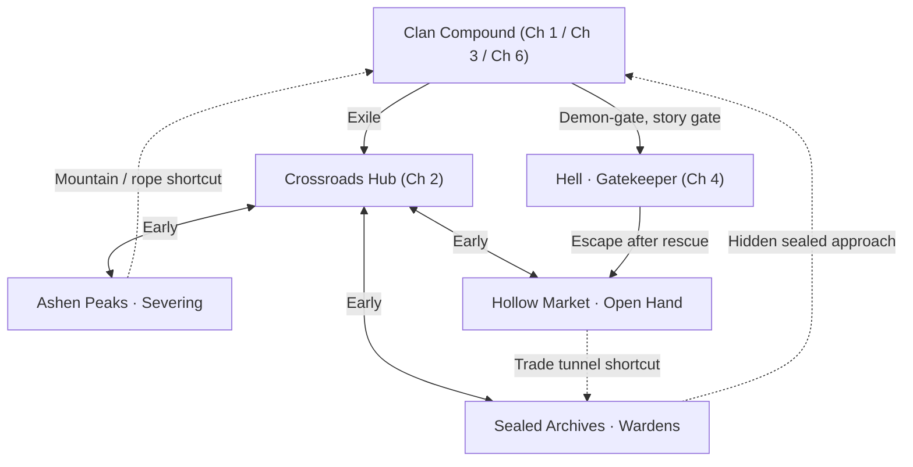

# KANAME — World Topology, Chapter Routing & Visual Regions

**Status:** Accepted *semi-open structure*, proposed internal geometry. This is a schematic **connectivity** map for later Unity scene/room design. It does not fix level dimensions, room positions or asset counts.

**Editable vector:** [rough_world_map.svg](references/rough_world_map.svg)  
**Main design bible:** [GAME_DESIGN_BIBLE.md](GAME_DESIGN_BIBLE.md)

## Legend and the red-path clarification
- **Solid pale path:** primary story or early-available connection; its use may require the chapter to reach the right narrative milestone (e.g. Chapter 4 demon-gate).
- **Turquoise dashed path:** *later shortcut*, optional passage or return route that becomes accessible after new movement or story interactions.
- **Red dashed mini-path / red inset:** **ability-gated route *inside* an otherwise accessible region** (e.g., high ridge requiring rope, archive corruption gate, locked market roof passage). It does **not** mean Ashen Peaks or Archives or Market are wholly locked at the beginning of Chapter 2.

## Navigation rule — Locked
- **All three Chapter 2 regions are explorable early**, but deep chambers/upper routes require abilities or keys.
- Exploration order is player-driven, main plot revelations are **fixed chapter milestones**; if player finds an early clue, word it as a hint rather than full reveal.
- Traversal unlocks should open two or more worthwhile old connections each; revisit old spaces for shortcuts, optional lore and resources.
- No enemy-level scaling assumed. Guide difficulty through geometry, danger, enemy moves and ability checks.
- Avoid building unique new versions of each region for Chapter 5. Use additive room connections, NPC states, hidden records and localized corruption/cleanup changes.

## Rough branch roles

### Crossroads Hub
Main rest-and-return node; an anchor from which Ashen Peaks, Sealed Archives and Hollow Market are visible/foreshadowed. Should have compact early paths to each branch and a few shortcuts opening later; not a sterile fast-travel menu.

### Ashen Peaks — Severing

Cold blue-grey mountains and ruined shrines, precarious cliff traversal, combat-first enemies, a tense parry duel. Accessible low terraces at start; deeper vertical shrine / upper ridges gated by rope or aerial movement. Late mountain path leads toward compound or archive as optional shortcut.

### Sealed Archives — Wardens

Pale-blue prison halls, vaults, seals, environmental puzzles, detained conscious Made and records of the clan. Early damaged lower hall available; deep cells and records behind corruption/seal obstacles. Later return especially important to Chapter 5 proof that limited restoration is possible. Warden Keeper encounter should not require murder.

### Hollow Market — Open Hand

Warm lantern-lit layered settlement/trade tunnels, healer, ferryman, recurring NPCs, small compassion scenes, roof bridges and alternate approaches. Settlement available early; deeper tunnels/rooftops open as traversal expands. Chapter 4 Hell exit returns player here at Chapter 5 transition.

**Important visual caveat:** The user preferred an **earlier** Hollow Market image in the conversation. That exact visual file was not available in the working container. The bundled image is a *generated concept-board crop* with compatible red-lantern mood **but is not asserted to be the chosen original**. Replace it when user supplies/downloads that image; preserve this Markdown image relative path.

### Clan Compound — Chapters 1, 3, 6
The same place gains layers:
1. Chapter 1: familiar safe rooms, gate, sanctum, small tutorial combat route.
2. Chapter 3: rooftop/cliff entry, family rooms, observation shaft below bedroom, masked council, prison/labs and gate.
3. Chapter 6: increasingly Hell-infused version, familiar landmarks remain recognizable, corruption, discarded masks, sanctum final boss.

### Hell — Chapter 4
Reached through beneath-compound gate. Includes Gatekeeper cages, caged Made/vessel failures, oppressive corridors with some warmth/human traces. After brother rescue player finds authored route to re-emerge in Hollow Market / Open Hand lands for Ch. 5.

## Text-only connectivity graph

**Note:** Mermaid graph shows conceptual edges, not necessarily teleportation or direct adjacent Unity scenes. Some links can be multi-room passages.

## Ability gate suggestions — Proposed not final
| Gate | Early hint | Later unlock | Revisit payoff |
|---|---|---|---|
| Severing cliff anchor | Rope ring above player | Rope grapple mastery in Ch. 2 | Shrine shortcut, optional lore |
| Archived corrupted door | Violet/red knot in stone | Abyssal Descent or major corruption clearing | Hidden records, Crimson Fragment |
| Market high roof bridge | Hanging point beyond jump | Double jump or grapple | Healer/merchant secret route |
| Compound high cliff | Visible former home skyline | Rope + aerial movement | Chapter 3 infiltration route |
| Deep Archives living cell | Distorted voices/seal tags | Chapter 5 advanced prompted binding | Partial restoration demonstration |
| Return to transformed sanctum | Familiar ceremonial hall | Chapter 6 narrative progression | Final Elder duel |

## Region reuse plan
- Ch. 2: introduce all three branches with strong distinct color, combat and narrative questions.
- Ch. 3: return to compound and reveal its vertical layers.
- Ch. 4: Hell gives new verticality/hostile architecture and can grant double jump.
- Ch. 5: return through Market; access newly meaningful Archive/Peaks contents; change NPC reactions; restore select Made.
- Ch. 6: return to same compound rooms corrupted by merge; reuse recognizable geometry for emotional payoff and solo-dev savings.

## Production instruction
Start with **Crossroads + one Ashen Peaks slice**, not every branch. Build one return route, one gated route, one enemy telegraph vocabulary and one readable story prop, then validate in Unity. Only after that template feels good should the other branches be expanded. Do not hardcode map from the concept art as a tilemap; art indicates mood only.
